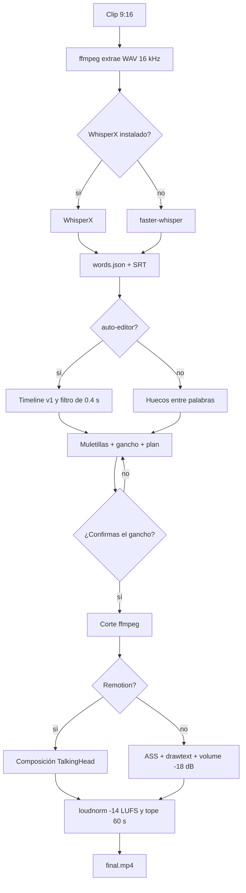
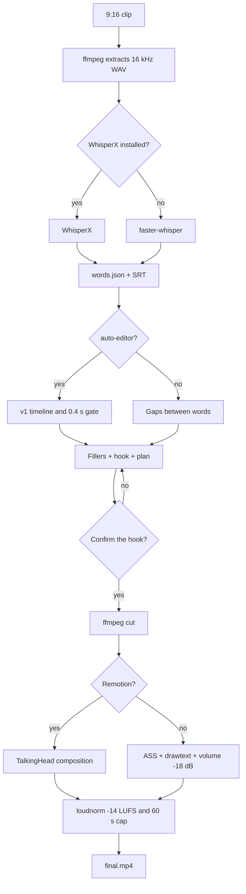

# adpros-ugc-talking-skill

Un skill de Claude que convierte un clip vertical de talking-head (el típico video de celular, 60–90 s, 9:16) en un MP4 listo para publicar: silencios cortados, muletillas fuera, subtítulos en bloques de 2–3 palabras, un gancho los primeros 3 segundos y una cama de música a unos −18 dB bajo la voz. Inglés y español.

A Claude Agent Skill that turns a raw vertical talking-head clip into a launch-ready MP4: silence and filler cuts, 2–3 word captions, a 3-second hook, and a music bed about −18 dB under the voice. English and Spanish.

Id público: `adpros-ugc-talking-skill`. En Claude Code se invoca con `/adpros-ugc-talking-skill`.
Public id: `adpros-ugc-talking-skill`. In Claude Code, invoke `/adpros-ugc-talking-skill`.

---

## Español

### Qué hace

Un solo pedido. Tú pasas el clip y Claude sigue `SKILL.md`:

1. Transcribe con marcas de tiempo por palabra (WhisperX si está instalado, si no faster-whisper). Sale `words.json` y un SRT.
2. Quita silencios de más de 0,4 s, dejando 0,05 s de aire a cada lado del corte.
3. Quita muletillas con listas en inglés y en español. El modo por defecto es conservador.
4. Propone un gancho en el idioma del clip y espera tu ok.
5. Renderiza en 1080×1920 con Remotion, o con FFmpeg si Remotion no está.
6. Normaliza a unos −14 LUFS y, si el corte pasa de 60 s, avisa y recorta.

No hace falta saber editar. Los tiempos los calculan los scripts, no el modelo.

### Requisitos

- macOS con Homebrew, o Linux con apt. El script de instalación se probó en Ubuntu 24.04. La rama de Homebrew no se ejecutó en una Mac en este repositorio.
- ffmpeg con libass, drawtext, libx264 y loudnorm
- Python 3.10 o más nuevo
- Node.js 18 o más nuevo, solo si quieres el render de Remotion
- Unos 2 GB libres para el modelo `small` en CPU. En GPU el modelo por defecto es `large-v3`

WhisperX es opcional. auto-editor es el motor de silencios preferido; si no está, el corte sale de los huecos entre palabras.

### Instalación en 5 minutos

```bash
git clone https://github.com/fabian-adpros/adpros-ugc-talking-skill.git
cd adpros-ugc-talking-skill
./install.sh
./doctor.sh
```

`install.sh` se puede correr otra vez: no duplica el venv ni reinstala ffmpeg si ya está. La primera transcripción descarga el modelo de Whisper al caché de Hugging Face. En CPU, `small` pesa unos 500 MB y esa primera vez puede tardar varios minutos. Las siguientes usan el archivo ya bajado.

WhisperX, si lo quieres:

```bash
INSTALL_WHISPERX=1 ./install.sh
```

### Instalar el skill

**Claude Code, para ti**

```bash
mkdir -p ~/.claude/skills
cp -R skills/adpros-ugc-talking-skill ~/.claude/skills/adpros-ugc-talking-skill
```

**Claude Code, solo en un proyecto**

```bash
mkdir -p .claude/skills
cp -R skills/adpros-ugc-talking-skill .claude/skills/adpros-ugc-talking-skill
```

**Desde GitHub, cuando el repo sea público** (`npx skills` busca `skills/*/SKILL.md`):

```bash
npx skills add fabian-adpros/adpros-ugc-talking-skill --skill adpros-ugc-talking-skill -a claude-code
```

Añade `-g` si lo quieres en tu usuario y no en el proyecto. `-y` evita las preguntas.

**claude.ai**

```bash
./scripts/package.sh
```

Eso deja `dist/adpros-ugc-talking-skill.zip` y `dist/adpros-ugc-talking-skill.skill`. Los dos son el mismo archivo. Dentro, la raíz es la carpeta `adpros-ugc-talking-skill/` y `SKILL.md` vive ahí. Un zip con `SKILL.md` suelto en la raíz no lo reconoce Claude. Súbelo en Ajustes → Capacidades → Skills.

El sandbox de claude.ai no trae ffmpeg ni Whisper. El skill está pensado para Claude Code en una máquina donde ya corriste `install.sh`.

### Migrar desde `ugc-talking-head`

La release [v0.1.0](https://github.com/fabian-adpros/adpros-ugc-talking-skill/releases/tag/v0.1.0) se queda como histórico y no se reemplaza. Si nunca instalaste `ugc-talking-head`, instala solo el id nuevo. Si esa carpeta ya existe, Claude puede descubrir los dos skills: muévela a un lado para desactivarla y conserva cualquier cambio que hayas hecho ahí. Se puede volver a activar moviendo el directorio a su nombre anterior. La invocación nueva es `/adpros-ugc-talking-skill`.

```bash
# Solo si ya existe una instalación previa. No borra la carpeta.
if [ -d "$HOME/.claude/skills/ugc-talking-head" ]; then
  mv "$HOME/.claude/skills/ugc-talking-head" "$HOME/.claude/skills/ugc-talking-head.disabled"
fi
if [ -d .claude/skills/ugc-talking-head ]; then
  mv .claude/skills/ugc-talking-head .claude/skills/ugc-talking-head.disabled
fi
npx skills add fabian-adpros/adpros-ugc-talking-skill --skill adpros-ugc-talking-skill -a claude-code -g -y
```

### Prompts de ejemplo

Español:

- «Edita este clip y déjalo listo para Reels.»
- «Quita los silencios y las muletillas, subtítulos grandes, y ponme un gancho.»
- «Edita este video en modo agresivo y usa esta canción de fondo.»
- «Sin preguntar, exporta el talking-head.» (se salta el checkpoint)

English:

- «Edit this clip. I need it launch-ready for TikTok.»
- «Remove the silences and the ums, bold captions, hook on the first three seconds.»
- «Aggressive filler cut, and use this music file.»
- «Just export it, don't ask.» (skips the approval stop)

### Configuración

El preset de ejemplo es [`skills/adpros-ugc-talking-skill/assets/preset.json`](skills/adpros-ugc-talking-skill/assets/preset.json).

| Clave | Default | Qué cambia |
| --- | --- | --- |
| `silence.min_seconds` | 0.4 | Solo se cortan silencios más largos que esto |
| `silence.padding_seconds` | 0.05 | Aire que se conserva a cada lado del corte |
| `silence.engine` | `auto` | `auto-editor`, `words`, o `auto` (auto-editor y si falla, palabras) |
| `silence.audio_threshold` | 0.04 | Umbral de auto-editor (`audio:threshold=`) |
| `fillers.mode` | `conservative` | `aggressive` quita más frases. Ver `assets/fillers.json` |
| `captions.max_words` | 3 | Palabras por tarjeta |
| `captions.highlight_active_word` | true | La palabra activa pasa a amarillo |
| `captions.y_ratio` | 0.75 | Centro vertical del subtítulo. 0.75 queda en la zona baja segura, por encima de la UI. No busca una cara |

Después del plan, `python scripts/ugc_edit.py storyboard --workdir DIR` escribe `DIR/export/` (guion gráfico, miniaturas, `storyboard.md`, SRT). `--inline` añade `storyboard.inline.html`, un solo HTML con las miniaturas en base64, sin red. El tope es `storyboard.inline_max_bytes` (1,5 MB por defecto); no está comprobado contra el límite real de artefactos de Claude.ai. `python scripts/ugc_edit.py export --workdir DIR --nle all` añade `project_premiere.xml` (XML de FCP 7, no FCPXML), `project.fcpxml` (FCPXML 1.11 de auto-editor 29) y, si instalaste `./install.sh --with-otio`, `timeline.otio` y `project.edl`. El video de origen se conforma a fps constantes antes de esos proyectos.
| `hook.duration_seconds` | 3 | Cuánto dura el texto del gancho |
| `music.file` | null | `null` usa `assets/music/bed.m4a`. O pasa `--music` |
| `music.duck_db` | -18 | La cama queda estos dB bajo la voz |
| `music.engine` | `volume` | `volume` es −18 dB fijos. `sidechain` además comprime con la voz |
| `export.max_duration` | 60 | Tope. Se recorta si `trim_if_over` es true |
| `export.lufs` | -14 | Loudness integrado |

Las listas de muletillas están en [`assets/fillers.json`](skills/adpros-ugc-talking-skill/assets/fillers.json). Inglés: um, uh, erm, like, you know, I mean, basically… Español: eh, este, o sea, pues, bueno, mmm, digamos, tipo, ¿me entiendes?… El modo conservador solo corta las claras, y las ambiguas (`este`, `like`, `pues`) únicamente si van solas. El modo agresivo también corta `you know`, `o sea`, `me entiendes` en medio de la frase. Whisper a menudo ni las transcribe: el plan lo dice, no lo escondas.

La cama que viene en el repo es un loop de acordes generado para este proyecto, sin track de terceros. Cámbiala por un archivo del que tengas derechos.

### Estructura

```text
skills/adpros-ugc-talking-skill/
├── SKILL.md
├── install.sh
├── doctor.sh
├── requirements.txt
├── references/          # detalle que Claude abre solo si lo necesita
├── assets/
│   ├── preset.json
│   ├── fillers.json
│   ├── fonts/Inter-Bold.ttf
│   └── music/bed.m4a
├── scripts/
│   ├── ugc_edit.py
│   └── lib/
└── template/            # proyecto Remotion
```

El repo además tiene `README.md`, `LICENSE`, `install.sh`, `doctor.sh`, `scripts/package.sh` y los demos en `examples/demo/`. La plantilla incluye `template/package-lock.json`, `template/public/placeholder.mp4` y `template/public/fonts/Inter-Bold.ttf`. La licencia SIL OFL 1.1 de Inter está en `assets/fonts/OFL.txt`.

### Pipeline



### Demos

`examples/demo/es.mp4` (9,5 s) y `examples/demo/en.mp4` (7,7 s) son renders técnicos de Remotion 4.0.541 a 1080×1920. Los dos ponen voz TTS sobre un fondo oscuro y muestran el gancho, subtítulos de pocas palabras con la palabra activa en amarillo, y la cama de música. En español el gancho es «Hoy te muestro cómo ahorrar tiempo». En inglés es «Today I'll show you the fastest way». El cuadro es un fondo oscuro: no aparece una persona ni un avatar, y no salen de un clip de celular.

### Problemas frecuentes

`./doctor.sh` primero. Si la transcripción se queda callada la primera vez, está bajando el modelo. Exit 10 no es un fallo: es el checkpoint del gancho. Si el plan dice que no había muletillas en el transcript, Whisper se las comió; no se pueden cortar. Más casos en [`references/troubleshooting.md`](skills/adpros-ugc-talking-skill/references/troubleshooting.md).

### Limitaciones

- Whisper se salta muletillas. `initial_prompt` ayuda un poco y a veces las inventa. No es un detector de «um» de verdad.
- auto-editor 29.3.1 no tiene `--smooth`. El mínimo de 0,4 s lo aplica este script sobre el timeline v1. Un build distinto puede cambiar los flags: el script no usa ninguno que no haya pasado por `--help` en 29.3.1.
- El umbral de audio de auto-editor depende del ruido de la sala. Si quiere borrar más del 70 % del clip, se pasa al corte por palabras.
- Remotion en una empresa de más de 3 personas necesita su licencia de pago. Ver créditos.
- No hay versión de Windows en esta fase. El render de Remotion a 1080×1920 pide RAM; el script usa `--concurrency=1`.
- La instalación con Homebrew está escrita y no se ejecutó en macOS aquí.
- El lugar de los subtítulos, el gancho en libass y el candado de sincronía se probaron con ffmpeg en Linux. No se volvieron a correr en macOS.
- `captions.y_ratio` es fijo. En un reveal el subtítulo puede tapar el producto. No hay seguimiento del objeto.
- El skill no traduce. Un clip en español sale en español.

### Roadmap (fase 2)

- Premiere y DaVinci a través de MCP, para entregar un timeline en vez de un MP4 cerrado
- VideoLingo para un doblaje o una traducción con subtítulos aparte
- HeyGen cuando el clip de entrada sea un avatar y no una toma real
- Variantes y ganchos A/B a partir del mismo transcript
- Windows, con rutas y un instalador que no dependa de Homebrew

### Créditos y licencias

Este repositorio es MIT. Copyright 2026 Fabián. Ver `LICENSE`.

| Pieza | Licencia | Nota |
| --- | --- | --- |
| [faster-whisper](https://github.com/SYSTRAN/faster-whisper) | MIT | Transcripción en CPU o GPU |
| Pesos de Whisper (OpenAI) | MIT | Se bajan al correr, no van en el repo |
| [CTranslate2](https://github.com/OpenNMT/CTranslate2) | MIT | Backend de faster-whisper |
| [WhisperX](https://github.com/m-bain/whisperX) | BSD-2-Clause | Opcional. Alineación con PyTorch |
| [auto-editor](https://github.com/WyattBlue/auto-editor) | Unlicense | El código del repo. Los binarios de las releases pueden arrastrar otras licencias |
| [FFmpeg](https://ffmpeg.org) | GPL o LGPL según el build | No se incluye. Hace falta el del sistema. Un build con libx264 suele ser GPL |
| [Remotion](https://www.remotion.dev/docs/license) | Licencia Remotion, no es OSI | Gratis para una persona o una empresa de hasta 3 personas, también en uso comercial. Empresas más grandes necesitan Company License |
| [Inter](https://github.com/rsms/inter) | SIL OFL 1.1 | `assets/fonts/`, ver `OFL.txt` |
| React | MIT | Dependencia de la plantilla |

La cama `assets/music/bed.m4a` es un loop original generado con ffmpeg para este repo.

### Publicar el repo en GitHub

```bash
# En github.com crea un repo vacío. Luego:
git remote add origin git@github.com:fabian-adpros/adpros-ugc-talking-skill.git
git push -u origin main
./scripts/package.sh
```

El repositorio es `fabian-adpros/adpros-ugc-talking-skill`. El id público del skill es `adpros-ugc-talking-skill`:

```bash
npx skills add fabian-adpros/adpros-ugc-talking-skill --skill adpros-ugc-talking-skill -a claude-code
```

El zip de `dist/` es el que se sube a claude.ai. `dist/` no se commitea. Un tag `v*` nuevo dispara `.github/workflows/release.yml`: si esa release no existe, la crea y adjunta `adpros-ugc-talking-skill.zip` y `adpros-ugc-talking-skill.skill`. No modifica la release v0.1.0. Claude Code instala la carpeta `skills/adpros-ugc-talking-skill` del repo.

---

## English

### What it does

One request. You hand over the clip and Claude follows `SKILL.md`:

1. Transcribe with word timestamps (WhisperX if it is installed, otherwise faster-whisper). You get `words.json` and an SRT.
2. Cut silences longer than 0.4s, leaving 0.05s of padding on each side.
3. Cut filler words with English and Spanish lists. The default mode is conservative.
4. Propose a hook in the clip's language and wait for a yes.
5. Render 1080×1920 with Remotion, or with FFmpeg when Remotion is not there.
6. Normalize to about −14 LUFS. If the cut is over 60s, warn and trim.

You do not need to edit. The scripts own the timestamps.

### Requirements

- macOS with Homebrew, or Linux with apt. `install.sh` was run on Ubuntu 24.04. The Homebrew branch was not executed on a Mac in this repo.
- ffmpeg with libass, drawtext, libx264, and loudnorm
- Python 3.10+
- Node.js 18+ only if you want the Remotion render
- About 2 GB free for the CPU `small` model. On a GPU the default model is `large-v3`

WhisperX is optional. auto-editor is the preferred silence engine. Without it, cuts come from gaps between words.

### Install in 5 minutes

```bash
git clone https://github.com/fabian-adpros/adpros-ugc-talking-skill.git
cd adpros-ugc-talking-skill
./install.sh
./doctor.sh
```

`install.sh` is safe to re-run. The first transcription downloads a Whisper model into the Hugging Face cache. On CPU, `small` is about 500 MB and that first run can take several minutes. Later runs reuse the file.

Optional WhisperX:

```bash
INSTALL_WHISPERX=1 ./install.sh
```

### Install the skill

**Claude Code, for you**

```bash
mkdir -p ~/.claude/skills
cp -R skills/adpros-ugc-talking-skill ~/.claude/skills/adpros-ugc-talking-skill
```

**Claude Code, this project only**

```bash
mkdir -p .claude/skills
cp -R skills/adpros-ugc-talking-skill .claude/skills/adpros-ugc-talking-skill
```

**From GitHub, once the repo is public** (`npx skills` looks for `skills/*/SKILL.md`):

```bash
npx skills add fabian-adpros/adpros-ugc-talking-skill --skill adpros-ugc-talking-skill -a claude-code
```

Add `-g` to install for your user instead of the project. `-y` skips the prompts.

**claude.ai**

```bash
./scripts/package.sh
```

That writes `dist/adpros-ugc-talking-skill.zip` and `dist/adpros-ugc-talking-skill.skill`. They are the same archive. The root inside the archive is the `adpros-ugc-talking-skill/` folder, and `SKILL.md` is inside that folder. A zip with a bare `SKILL.md` at the root is not recognized. Upload it under Settings → Capabilities → Skills.

The claude.ai sandbox does not ship ffmpeg or Whisper. Use the skill from Claude Code on a machine where `install.sh` has run.

### Migrate from `ugc-talking-head`

Release [v0.1.0](https://github.com/fabian-adpros/adpros-ugc-talking-skill/releases/tag/v0.1.0) stays as the historical download and is not replaced. If you never installed `ugc-talking-head`, install only the new id. If that folder is already present, Claude can discover both skills: move it aside to disable it, and keep any customizations you made there. Move `ugc-talking-head.disabled` back to `ugc-talking-head` to turn the old copy on again. The new invocation is `/adpros-ugc-talking-skill`.

```bash
# Only when a previous install exists. This moves the folder; it does not delete it.
if [ -d "$HOME/.claude/skills/ugc-talking-head" ]; then
  mv "$HOME/.claude/skills/ugc-talking-head" "$HOME/.claude/skills/ugc-talking-head.disabled"
fi
if [ -d .claude/skills/ugc-talking-head ]; then
  mv .claude/skills/ugc-talking-head .claude/skills/ugc-talking-head.disabled
fi
npx skills add fabian-adpros/adpros-ugc-talking-skill --skill adpros-ugc-talking-skill -a claude-code -g -y
```

### Example prompts

Spanish:

- «Edita este clip y déjalo listo para Reels.»
- «Quita los silencios y las muletillas, subtítulos grandes, y ponme un gancho.»
- «Edita este video en modo agresivo y usa esta canción de fondo.»
- «Sin preguntar, exporta el talking-head.» (skips the checkpoint)

English:

- «Edit this clip. I need it launch-ready for TikTok.»
- «Remove the silences and the ums, bold captions, hook on the first three seconds.»
- «Aggressive filler cut, and use this music file.»
- «Just export it, don't ask.» (skips the approval stop)

### Configuration

The sample preset is [`skills/adpros-ugc-talking-skill/assets/preset.json`](skills/adpros-ugc-talking-skill/assets/preset.json).

| Key | Default | Effect |
| --- | --- | --- |
| `silence.min_seconds` | 0.4 | Only silences longer than this are cut |
| `silence.padding_seconds` | 0.05 | Audio kept on each side of a cut |
| `silence.engine` | `auto` | `auto-editor`, `words`, or `auto` (auto-editor, then word gaps) |
| `silence.audio_threshold` | 0.04 | auto-editor threshold (`audio:threshold=`) |
| `fillers.mode` | `conservative` | `aggressive` removes more phrases. See `assets/fillers.json` |
| `captions.max_words` | 3 | Words per caption card |
| `captions.highlight_active_word` | true | The active word turns yellow |
| `captions.y_ratio` | 0.75 | Vertical center of the caption line. 0.75 sits in the lower safe area, above the UI. It does not look for a face |

After the plan, `python scripts/ugc_edit.py storyboard --workdir DIR` writes `DIR/export/` (storyboard, thumbnails, `storyboard.md`, SRT). `--inline` also writes `storyboard.inline.html`, one HTML file with base64 thumbnails and no network. The cap is `storyboard.inline_max_bytes` (1.5 MB by default). That cap was not checked against Claude.ai's real artifact limit. `python scripts/ugc_edit.py export --workdir DIR --nle all` adds `project_premiere.xml` (FCP 7 XML, not FCPXML), `project.fcpxml` (FCPXML 1.11 from auto-editor 29) and, if you installed with `./install.sh --with-otio`, `timeline.otio` and `project.edl`. The source is conformed to a constant frame rate before those projects.
| `hook.duration_seconds` | 3 | How long the hook stays up |
| `music.file` | null | `null` uses `assets/music/bed.m4a`. Or pass `--music` |
| `music.duck_db` | -18 | Bed level under the voice |
| `music.engine` | `volume` | `volume` is a fixed −18 dB. `sidechain` also ducks with the voice |
| `export.max_duration` | 60 | Cap. Trimmed when `trim_if_over` is true |
| `export.lufs` | -14 | Integrated loudness |

Filler lists live in [`assets/fillers.json`](skills/adpros-ugc-talking-skill/assets/fillers.json). English: um, uh, erm, like, you know, I mean, basically… Spanish: eh, este, o sea, pues, bueno, mmm, digamos, tipo, ¿me entiendes?… Conservative mode cuts clear fillers, and ambiguous ones (`este`, `like`, `pues`) only when they stand alone. Aggressive mode also cuts `you know`, `o sea`, and `me entiendes` mid-sentence. Whisper often never writes them down. The plan says so. Report that, do not claim they were removed.

The bed in the repo is an original chord loop generated for this project. Swap it for a file you have rights to.

### Layout

```text
skills/adpros-ugc-talking-skill/
├── SKILL.md
├── install.sh
├── doctor.sh
├── requirements.txt
├── references/          # detail Claude opens only when a step needs it
├── assets/
│   ├── preset.json
│   ├── fillers.json
│   ├── fonts/Inter-Bold.ttf
│   └── music/bed.m4a
├── scripts/
│   ├── ugc_edit.py
│   └── lib/
└── template/            # Remotion project
```

The repo also has `README.md`, `LICENSE`, `install.sh`, `doctor.sh`, `scripts/package.sh`, and the demos in `examples/demo/`. The template includes `template/package-lock.json`, `template/public/placeholder.mp4`, and `template/public/fonts/Inter-Bold.ttf`. Inter's SIL OFL 1.1 text is `assets/fonts/OFL.txt`.

### Pipeline



### Demos

`examples/demo/es.mp4` (9.5 s) and `examples/demo/en.mp4` (7.7 s) are Remotion 4.0.541 technical renders at 1080×1920. Both put TTS speech on a dark background and show the hook, short captions with the active word in yellow, and the music bed. The Spanish hook is «Hoy te muestro cómo ahorrar tiempo». The English hook is «Today I'll show you the fastest way». The frame is a dark background: no person and no avatar appear, and the files are not phone clips.

### Troubleshooting

Run `./doctor.sh` first. A quiet first transcription is the model download. Exit code 10 is the hook checkpoint, not a failure. If the plan says the transcript had no fillers, Whisper dropped them and they cannot be cut. More cases are in [`references/troubleshooting.md`](skills/adpros-ugc-talking-skill/references/troubleshooting.md).

### Limitations

- Whisper drops fillers. `initial_prompt` helps a little and can also invent them. It is not a real "um" detector.
- auto-editor 29.3.1 has no `--smooth`. This script applies the 0.4s minimum on the v1 timeline. A different build can change flags. The script only passes flags that `--help` accepted on 29.3.1.
- auto-editor's threshold depends on room tone. If it would delete more than 70% of the clip, the script switches to word gaps.
- Remotion at a company larger than 3 people needs their paid license. See credits.
- No Windows support in this phase. A 1080×1920 Remotion render is heavy; the script already passes `--concurrency=1`.
- The Homebrew install path is written and was not executed on macOS here.
- Caption placement, the libass hook, and the sync lock were checked with ffmpeg on Linux. They were not run again on macOS.
- `captions.y_ratio` is a fixed line. During a product reveal the captions can cover the product. There is no object tracking.
- The skill does not translate. A Spanish clip stays in Spanish.

### Roadmap (phase 2)

- Premiere and DaVinci through MCP, so the delivery can be a timeline instead of a baked MP4
- VideoLingo for a dub or a separate translated subtitle pass
- HeyGen when the source is an avatar rather than a real take
- Variants and A/B hooks from the same transcript
- Windows, with paths and an installer that does not assume Homebrew

### Credits and licenses

This repo is MIT. Copyright 2026 Fabián. See `LICENSE`.

| Piece | License | Note |
| --- | --- | --- |
| [faster-whisper](https://github.com/SYSTRAN/faster-whisper) | MIT | CPU or GPU transcription |
| Whisper weights (OpenAI) | MIT | Downloaded at runtime, not committed |
| [CTranslate2](https://github.com/OpenNMT/CTranslate2) | MIT | faster-whisper backend |
| [WhisperX](https://github.com/m-bain/whisperX) | BSD-2-Clause | Optional. Alignment needs PyTorch |
| [auto-editor](https://github.com/WyattBlue/auto-editor) | Unlicense | The repo. Release binaries can pull in other licenses |
| [FFmpeg](https://ffmpeg.org) | GPL or LGPL depending on the build | Not vendored. A build with libx264 is usually GPL |
| [Remotion](https://www.remotion.dev/docs/license) | Remotion License, not OSI open source | Free for an individual or a company of up to 3 people, including commercial use. Larger companies need a Company License |
| [Inter](https://github.com/rsms/inter) | SIL OFL 1.1 | `assets/fonts/`, see `OFL.txt` |
| React | MIT | Template dependency |

`assets/music/bed.m4a` is an original loop generated with ffmpeg for this repo.

### Publish the GitHub repo

```bash
# Create an empty repo on github.com, then:
git remote add origin git@github.com:fabian-adpros/adpros-ugc-talking-skill.git
git push -u origin main
./scripts/package.sh
```

The repository is `fabian-adpros/adpros-ugc-talking-skill`. The public skill id is `adpros-ugc-talking-skill`:

```bash
npx skills add fabian-adpros/adpros-ugc-talking-skill --skill adpros-ugc-talking-skill -a claude-code
```

The zip in `dist/` is what you upload to claude.ai. `dist/` is not committed. A new `v*` tag runs `.github/workflows/release.yml`: if that release does not exist yet, the workflow creates it and attaches `adpros-ugc-talking-skill.zip` and `adpros-ugc-talking-skill.skill`. It does not modify the v0.1.0 release. Claude Code installs the `skills/adpros-ugc-talking-skill` folder from the repo.
